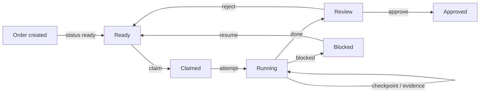

# winch

**Pull-based delivery backlog for coding agents.**

Winch is a pull-based delivery backlog - epic to story to task with a dependency
DAG - served as an MCP server. The spec lives in the records: a planner writes
it once, a worker reads it, claims atomically, and reports back. `serve --ws`
streams every store event, so a harness wakes agents from the queue instead of
polling it.

Winch is harness-agnostic: the server contains no harness-specific code. The
adapters under `plugins/` are optional and installed per harness; the MCP
contract itself is the only integration surface.

- **Spec in the records** - goal, acceptance criteria, dependencies, capabilities all written once by the planner.
- **Atomic claim** - CAS under a lease; highest-priority ready task selected when no id is given.
- **Dependency DAG** - forward-only deps, cycle-checked, cancelled deps count as resolved.
- **Event stream** - every store insert broadcast over WebSocket; subscribers wake agents, no polling.
- **Human gates** - block/resume with gate types; one resume per gate, actor-checked.
- **Content-addressed evidence** - artifacts recorded on close, carried into downstream handoffs.

It is local-first and harness-neutral: OpenCode, OpenClaw and future harnesses
are adapters, not the product. A work order is self-contained - no external
planner task id is required. Stable releases publish since `2026.11.9`.

[Why the name?](#why-the-name)

## Install

Requires Node.js 22+.

GitHub Packages requires a personal access token with `read:packages` scope
(classic PAT - fine-grained tokens do not support package read). Configure
your npmrc with the registry and token, then install:

    npm install -g @igorjpimenta/winch
    winch --version

The harness adapters publish on their own release lines and can use the same or
different winch versions than the daemon:
`@igorjpimenta/winch-openclaw` and `@igorjpimenta/winch-opencode`.
A `beta` dist-tag tracks prereleases (`YYYY.MM.DD-beta.N`).

From source instead: `npm install`, then `./bin/winch.js <command>` - or
`npm link` for a global `winch`.

## Quick start

Start the daemon and claim your first work order:

    WINCH_HARNESS=test winch serve --mcp stdio &

Inside your harness agent:

    backlog_plan   { epic: { title: "my first epic" },
                     stories: [{ title: "S1", tasks: [{ title: "do the thing" }] }] }
    backlog_claim  { taskId: "TASK-..." }     # identity stamped by the plugin
    backlog_done   { taskId: "TASK-...", resultSummary: "done" }

Verify from the operator side - no transcript reading:

    $ winch next          # task gone from the ready queue
    $ winch serve --ws    # watch the event stream light up

All MCP tools and their contracts are defined in `src/tools/` - or just list
them from the running server.

## How it fits together

- The **Store** is one SQLite database (`~/.winch/store.sqlite`) - the single
  source of truth, migrations applied on open.
- The **MCP server** exposes the whole backlog as tools over stdio (one pipe per
  harness) or streamable HTTP (one shared daemon). Identity is stamped at the
  transport edge.
- The **Event stream** (`winch serve --ws`) and claim webhooks notify dashboards
  and wake idle agents when work arrives.
- **Harness adapters** (`@igorjpimenta/winch-openclaw`, `@igorjpimenta/winch-opencode`)
  stamp identity, checkpoint on turn end (OpenClaw), and receive claim webhooks.
  The optional wake bridge prompts an OpenCode session when a webhook fires.

    harness agent --MCP (stdio | HTTP + X-Winch-Harness)--> MCP server --> SQLite store
                                                              |  claim webhook / event stream
                                                              v
                                                        wake bridge -> idle harness agent

## Identity

Every call is keyed `harness:agent:session`, and the harness is declared per
**connection**, never by the model:

| Transport | Harness declared by | Example |
| --- | --- | --- |
| stdio | `WINCH_HARNESS` env at launch | one pipe per harness |
| HTTP | `X-Winch-Harness` header on the session's first request | one shared daemon, all harnesses |

The agent and session halves are stamped per call as a whole pair, in **one**
channel: either `_meta.winch` (`{ agent, session, harness }`) or flat
`winch_agent` / `winch_session` arguments - halves never splice across
channels. Mutating calls without a full pair refuse; the adapters do this
stamping automatically. Full contract, per-dimension table and adapter setup:
[plugins/README.md](plugins/README.md).

## Harnesses

An adapter attaches to an existing order; it never creates work.

**OpenClaw** - `@igorjpimenta/winch-openclaw` stamps `_meta.winch`,
checkpoints on turn end, resumes from the latest checkpoint, and receives claim
webhooks at `POST /api/winch/claimed`.

    openclaw plugins install npm:@igorjpimenta/winch-openclaw@latest

One daemon for all harnesses (recommended):

    {
      "mcp": {
        "servers": {
          "winch": {
            "url": "http://127.0.0.1:38292/mcp",
            "headers": {
              "X-Winch-Harness": "openclaw",
              "Authorization": "Bearer <WINCH_BEARER>"
            }
          }
        }
      }
    }

One pipe per harness instead:

    {
      "mcp": {
        "servers": {
          "winch": {
            "command": "winch",
            "args": ["serve", "--mcp", "stdio"],
            "env": { "WINCH_HARNESS": "openclaw" }
          }
        }
      }
    }

**OpenCode** - `@igorjpimenta/winch-opencode` stamps identity on every winch
MCP tool call. It needs the winch MCP server configured and `WINCH_AGENT` when
the session agent cannot be captured.

OpenCode reads config from `opencode.json(c)` (project root or `.opencode/`,
global at `~/.config/opencode/`). V1 configs normalize into V2, but write V2
canonical form for new setup:

    {
      "$schema": "https://opencode.ai/config.json",
      "mcp": {
        "servers": {
          "winch": {
            "type": "remote",
            "url": "http://127.0.0.1:38292/mcp",
            "headers": {
              "X-Winch-Harness": "opencode",
              "Authorization": "Bearer <WINCH_BEARER>"
            }
          }
        }
      },
      "plugins": ["@igorjpimenta/winch-opencode"]
    }

Or via the CLI:

    opencode mcp add winch --url http://127.0.0.1:38292/mcp \
      --header "X-Winch-Harness=opencode" \
      --header "Authorization=Bearer <WINCH_BEARER>"
    opencode plugin add @igorjpimenta/winch-opencode

Automatic checkpoint/resume is not part of the OpenCode adapter; the agent uses
the winch MCP tools directly. The optional wake bridge receives the claim
webhook and prompts the claiming session through the OpenCode SDK.

## MCP tools

| tool | what it does |
| --- | --- |
| `backlog_plan` | create an epic with its stories and tasks in one call; the spec is written into the records |
| `backlog_append` | add stories to an epic and/or tasks to a story after the plan, unassigned, for the planner to route |
| `backlog_drop` / `backlog_restore` | disable an epic, story or task that was never claimed, and bring it back; claimed work can only be closed |
| `backlog_assign` | set or clear an assignee on a task (it claims and delivers) or a story (its owner breaks it into tasks); that row is what wakes the assignee |
| `backlog_get` | read an epic, story or task by id - acceptance, results, artifacts, dependencies, readiness |
| `backlog_claim` | claim one task by id, or the highest-priority ready task when the id is omitted; atomic CAS under a lease |
| `backlog_update` | heartbeat and append progress, comment or artifact to a claimed task |
| `backlog_done` | close a claimed task with a result; closing the last task closes its story, and the last story closes the epic and wakes the agent that planned it |
| `backlog_block` / `backlog_resume` | open a human gate (with optional `gateType` and `blockedBy` dep edge) and resolve it (`actor` optional) |

## The order lifecycle

An order moves from ready through a claim and a running task to review. The
verdict decides where it lands, and resume returns rejected or blocked work to
ready.

Claim leases, attempt caps, and the checkpoint/evidence validation rules:
[lifecycle](docs/lifecycle.md).

## Documentation

| Goal | Start here |
| --- | --- |
| Configure ports, bearer, store, webhooks | [Configuration](docs/configuration.md) |
| Understand claim/lease/verdict rules | [Lifecycle](docs/lifecycle.md) |
| Wake idle agents on claims | [Webhooks and wake bridge](docs/webhooks.md) |
| Run it on a host persistently | [Docker](docs/docker.md) |
| Publish a release | [Releases](docs/releases.md) |

## CLI

| command | what it does |
| --- | --- |
| `serve --mcp stdio` | serve the backlog tools over MCP stdio (env-only harness) |
| `serve --mcp http --port N [--host H]` | serve the same tools over Streamable HTTP (shared daemon) |
| `watch` | one watcher tick (JSON manifest on stdout) |
| `resume <taskId> [--actor <name>]` | resolve a human gate: blocked to todo |
| `next` | list the current ready queue |
| `release-epic --epic <id> [--task ID] [--version V] [--base B]` | release notes + branch/PR with backlog markers |
| `merge-detect [--dry-run]` | apply merged/closed PR outcomes |
| `webhook set --harness H --url U [--bearer B]` | register a harness callback URL (checked first at claim) |
| `webhook list` / `webhook remove --harness H` | inspect / drop registered callback URLs |
| `webhook test --harness H` | POST a test ping to the harness target |
| `serve --ws --port N [--host H]` | stream store events over WebSocket |

## Deploy (any server)

Winch is cloud-agnostic: the portable build is the container below - plain
Node + a SQLite file on a volume, no cloud SDKs or provider APIs. Run it on
any VPS, compose host or cluster with one replica (SQLite has one writer).

    docker build -t winch .
    docker run -d --name winch --restart unless-stopped \
      -e WINCH_BEARER="$(openssl rand -base64 32)" \
      -v winch-data:/data -p 38292:38292 winch
    # or: WINCH_BEARER=... docker compose up -d --build

- The container listens on `WINCH_MCP_HTTP_PORT` (default 38292); `GET /health`
  is unauthenticated (load-balancer / `HEALTHCHECK` probe); everything else
  needs `Authorization: Bearer <WINCH_BEARER>`.
- Terminate TLS in front (Caddy / Traefik / ingress); point harnesses at
  `https://<host>/mcp` with the bearer + `X-Winch-Harness` headers - the
  same contract as `serve --mcp http` locally. LangGraph needs no local
  spawn: `streamablehttp_client` straight to the URL.
- The volume holds `WINCH_DB` (`/data/store.sqlite` in the image); back it
  up like any stateful file. Never bake `WINCH_BEARER` into the image.
- The lease sweeper is a tick, not a daemon: run `watch` on a host cron (or
  a second one-shot service) against the same DB file when co-located; skip
  it when the DB lives elsewhere - claims still self-heal on next tick.

## Events stream

`winch serve --ws [--port N] [--host H]` (default port 38291, localhost-only
unless `--host` says otherwise) tails the events table and broadcasts every
new row to all connected clients as JSON text frames:

- `{"type":"welcome","lastEventId":N}` on connect, then
  `{"type":"history","events":[...]}` (newest 200), then
- `{"type":"event","kind":"task.completed","id":N,"at":T,"task":{id,title,
  story,epic,acceptance,artifacts,assignee},"actor":"...","note":"..."}` per
  insert, in id order.

Kinds on the wire come in three families - `task.*` for task lifecycle,
`gate.*` for gate lifecycle, `release.*` for shipment - each declared by its
producer at write time and stored on the row's `kind` column. A shipped row
asserts a tag exists: merge-detect tags first and writes nothing on tag
failure. The emitter feeds the stored kind straight through; otherwise a row
maps by transition structure alone. Notes never classify anything: they are
free text and can change, so pre-kind rows keep exactly the meanings they
streamed with - an append-only log keeps its history.
The closed catalog lives in `src/events-ws.js` and is named here by family
only, so the two cannot drift. History and live rows share one envelope shape.

Delivery-dynamics notes the wire will not tell you: heartbeats renew the claim
lease (only silence gets swept); an unmerged close dissolves its gate (late
approvals answer `gate_dissolved`); starvation lives in the watcher manifest
(`deferred` list, per-task `idleMs`), not the stream; a disputed completion is
a new ticket linked by dep edge with a `supersedes: TASK-x` note, never a
rewrite of history.

Typed kinds and embedded task context land in follow-up work; this surface
streams rows verbatim.

The server never interprets a row - a gate opening is just another event, and
reminders, digests and dashboards are subscriber code. Reconnect replays
history, so a missed frame costs a re-read, never a lost event. No auth in
process: keep the loopback bind, or put a bearer-checked reverse proxy in
front. Plain HTTP hits get 404.

## Store

DB path resolution: `WINCH_DB` -> `~/.winch/store.sqlite`. The store is
winch's, not the launching harness's.

Schema lives in `src/schema.js` as Drizzle tables. `npm run db:generate`
turns schema changes into SQL in `.migrations/`; `src/db.js` applies pending
migrations on open, and `npm run db:migrate` does the same explicitly for a
deploy. The files are plain SQL and may be edited before they are applied for
data backfills, triggers, or renames; an applied migration is a snapshot, so
append a new one instead of editing it.

Concurrency note: concurrent access to the sqlite file - server, watcher and
CLI processes at once - is safe under WAL mode, and
[test/store.race.test.js](test/store.race.test.js)
races 4 real OS processes with independent handles through one claim to prove
the CAS transaction boundary under WAL contention.

## Identity

Every claim is keyed `harness:agent:session`. The **harness is declared at
construction** - `winch serve --mcp stdio` will not start without
`WINCH_HARNESS` in the environment, because an unnamed server cannot attribute
anything. The agent and session of each call are stamped per call by the
calling harness's companion plugin (`_meta.winch`), which overwrites
unconditionally, so model-supplied meta cannot impersonate an agent. A call
whose agent or session is unstamped fails loudly instead of minting a default
key. Full contract, per-dimension table and harness adapter setup snippets:
[plugins/README.md](plugins/README.md).

## Configuration

Tuning knobs are declared the way the harness is - and none of them is
required. Precedence per knob: per-call `_meta.winch.config` > constructor
`{ config }` (`createStore`, `--config JSON|PATH` on `mcp`/`serve`/`watch`)
> `WINCH_*` env > code default. An undeclared server behaves exactly like
the old hardcoded one. Malformed values refuse (bad key named) at startup
for construction config, per call for meta overlay; unknown explicit keys
refuse as likely typos, unknown meta keys are ignored for forward compat.

| knob | env | default |
|---|---|---|
| Claim lease | `WINCH_LEASE_SECONDS` | 1800 (30 min) |
| Sweeper max attempts | `WINCH_MAX_ATTEMPTS` | 3 |
| Gate-wait thresholds | `WINCH_GATE_WAIT_LEVELS` (`"24h,72h"`, `ms|s|m|h|d` suffixes) | 24h / 72h |
| WS port / history / poll | `WINCH_WS_PORT` / `WINCH_WS_HISTORY_LIMIT` / `WINCH_WS_INTERVAL_MS` | 38291 / 200 / 1000 ms |
| MCP HTTP port | `WINCH_MCP_HTTP_PORT` | 38292 |
| DB path | `WINCH_DB` | `~/.winch/store.sqlite` |
| Claim webhook URL / bearer / timeout | `WINCH_CLAIM_WEBHOOK_URL` / `WINCH_CLAIM_WEBHOOK_BEARER` / `WINCH_CLAIM_WEBHOOK_TIMEOUT_MS` | unset / unset / 3000 ms |
| Claim webhooks per harness (map) | `WINCH_CLAIM_WEBHOOKS` (`{"openclaw":{"url":"...","bearer":"..."}}`) | `{}` (falls back to single URL) |
| Wake routing cap | `WINCH_MAX_ACTIVE_PER_AGENT` | 2 |
| Scan limits (tick / candidates / blocked list) | `WINCH_SCAN_LIMIT` / `WINCH_CANDIDATES` / `WINCH_BLOCKED_LIMIT` | 50 / 5 / 20 |
| Dep cycle-check cap | `WINCH_DFS_NODES` | 500 nodes |
| Note caps (progress / result / reason / artifact) | `WINCH_NOTE_{PROGRESS,RESULT,REASON,ARTIFACT}_LIMIT` | 2000 / 4000 / 1000 / 500 |
| Artifacts per done | `WINCH_MAX_ARTIFACTS` | 50 |

## Troubleshooting

| Refusal message | Cause | Fix |
| --- | --- | --- |
| "refused caller identity (unresolved agent and session)" | No `_meta.winch` and no `winch_agent`/`winch_session` args | Ensure the companion plugin is installed and stamping; for OpenCode set `WINCH_AGENT` |
| "halves in different channels - pairs never splice" | Agent from one channel, session from another | Stamp both in the same channel (`_meta.winch` or flat args) |
| "refused declaration (missing: harness)" | `WINCH_HARNESS` unset on stdio, or `X-Winch-Harness` missing on HTTP | Set the env var or add the header |
| "refused declaration (reserved: harness)" | Harness name is `unknown` or `instance:*` | Use a real harness name |
| "not found: TASK-..." | Task id does not exist | Check the id; tasks may have been dropped or never created |
| "is in_progress, not todo" | Task already claimed | Wait for completion or reassign via `backlog_assign` |
| "not_ready" on claim | Unmet dependency or capability mismatch | Check deps with `backlog_get`; offer matching capabilities |

## Why the name?

A winch is the machine that pulls a load up a slope - it does not push, it
does not carry, it pulls. Winch pulls work orders through a dependency DAG:
a planner loads the load at the bottom, agents pull tasks up the slope, and
the store records every meter of progress. The name is the mechanism.

## Development

    npm install
    npm test
    node bin/winch.js --help

## License

MIT
