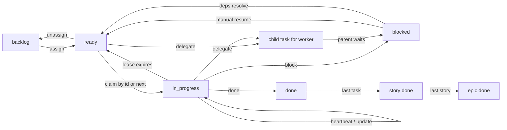

# winch

**Pull-based delivery backlog for coding agents.**

Winch is a pull-based delivery backlog - epic to story to task with a dependency
DAG - served as an MCP server. The spec lives in the records: a planner writes
it once, a worker reads it, claims atomically, and reports back. Webhook wakes
fan every work-making transition out to consumers, so a harness wakes agents
from the queue instead of polling it.

Winch is harness-agnostic: the server contains no harness-specific code. The
adapters under `plugins/` are optional and installed per harness; the MCP
contract itself is the only integration surface.

- **Spec in the records** - goal, acceptance criteria, dependencies, capabilities all written once by the planner.
- **Atomic claim** - CAS under a lease; highest-priority ready task selected when no id is given.
- **Dependency DAG** - forward-only deps, cycle-checked, cancelled deps count as resolved.
- **Webhook wakes** - every work-making transition fans out to consumer webhooks; subscribers wake agents, no polling.
- **Human gates** - block/resume with gate types; one resume per gate, actor-checked.
- **Human-gated artifacts** - attaching a `pr`/`release`/`design` artifact spawns a review child for the reserved `human` pair and parks the parent until it resolves.
- **Content-addressed evidence** - artifacts recorded on close, carried into downstream handoffs.

It is local-first and harness-neutral: OpenCode, OpenClaw and future harnesses
are adapters, not the product. A work order is self-contained - no external
planner task id is required. Stable releases publish since `2026.11.9`.

[Why the name?](#why-the-name)

## Install

Requires Node.js 22+.

    npm install -g @igorjpimenta/winch
    winch --version

The harness adapters publish on their own release lines and can use the same or
different winch versions than the daemon:
`@igorjpimenta/winch-openclaw` and `@igorjpimenta/winch-opencode`.
A `beta` dist-tag tracks prereleases (`YYYY.MM.DD-beta.N`); until an adapter's
first stable exists, its versionless install serves the newest beta.

From source instead: `npm install`, then `./bin/winch.js <command>` - or
`npm link` for a global `winch`.

## Quick start

Start the daemon and claim your first work order:

    WINCH_HARNESS=test winch serve --mcp stdio &

Inside your harness agent:

    backlog_plan   { epic: { title: "my first epic" },
                     stories: [{ title: "S1", tasks: [{ title: "do the thing" }] }] }
    backlog_claim  { taskId: "<item-id>" }    # identity stamped by the plugin
    backlog_done   { taskId: "<item-id>", resultSummary: "done" }

Verify from the operator side - no transcript reading:

    $ winch next          # task gone from the ready queue
    $ winch webhook serve # watch the wake pump light up

All MCP tools and their contracts are defined in `src/tools/` - or just list
them from the running server.

## How it fits together

- The **Store** is one SQLite database (`~/.winch/store.sqlite`) - the single
  source of truth, migrations applied on open.
- The **MCP server** exposes the whole backlog as tools over stdio (one pipe per
  harness) or streamable HTTP (one shared daemon). Identity is stamped at the
  transport edge.
- The **Dispatch server** (`winch webhook serve`) accepts executor
  registration and recovery, pumps `admission_queue`, and fans wakes out to
  consumer webhooks. Tasks accept with MCP `backlog_claim`; planner wakes accept
  with `backlog_accept_wake`.
- **Harness adapters** (`@igorjpimenta/winch-openclaw`, `@igorjpimenta/winch-opencode`)
  stamp identity, checkpoint on turn end (OpenClaw), receive dispatch webhooks
  on a plugin-local listener, and reconcile assigned `in_progress` work after a
  restart.

    harness agent --MCP (stdio | HTTP + X-Winch-Harness)--> MCP server --> SQLite store
                                                              |
                                                    admission_queue / delivery ledger
                                                              v
                         dispatch server --> consumer webhook --> plugin listener --> agent

## Identity

Every call is keyed `harness:agent:session`, and the harness is declared per
**connection**, never by the model:

| Transport | Harness declared by | Example |
| --- | --- | --- |
| stdio | `WINCH_HARNESS` env at launch | one pipe per harness |
| HTTP | `X-Winch-Harness` header on the session's first request | one shared daemon, all harnesses |

The agent and session halves are stamped per call as a whole pair, in **one**
channel: either `_meta.winch` (`{ agent, session, harness }`) or flat
`winch_agent` / `winch_session` arguments - halves never splice across
channels. Mutating calls without a full pair refuse; the adapters do this
stamping automatically. Full contract, per-dimension table and adapter setup:
[plugins/README.md](plugins/README.md).

## Dispatch

`winch webhook serve` hosts the HTTP dispatch endpoints and the wake pump. It
is the single scheduler:

- It routes work-making transitions: `task.created`, `task.assigned`,
  `task.released`, `task.restored`, `gate.resolved`, `story.created`,
  `story.assigned`, `task.appended` (to the epic creator), and
  `epic.completed` (to the epic creator).
- It writes each wake to `admission_queue`, creates a stable `dispatch_events`
  row, one delivery row for the attempt's owner, and a per-attempt audit row.
  Only the owner is delivered to, as `execution: "active"`; the other consumers
  of the harness are not poked at all. If the owner fails or its lease expires,
  the dispatcher hands the attempt to another consumer, bumps `leaseEpoch`, and
  delivers that as active.
- An offer reserves capacity until it is claimed, closes, or expires. Failed
  deliveries and expired offers requeue with backoff. Planner wakes
  (`story`/`append`/`review`) are one-shot only after `backlog_accept_wake`
  takes the execution lease; an unaccepted wake requeues. A 4xx disables that
  subscription; transient failures retry until the failure threshold or attempt
  cap. A heartbeat does not erase that state.
- Caps are per harness (`WINCH_DISPATCH_HARNESS_MAX`) and global
  (`WINCH_DISPATCH_GLOBAL_MAX`). A consumer's running wake children are capped
  by `WINCH_DISPATCH_WAKE_MAX`: a delivery counts as running until the receiver
  settles it, so an offer re-offered while its child is alive cannot stack a
  second process. The server listens on
  `WINCH_DISPATCH_PORT` (default 38293, localhost-only unless `--host` says
  otherwise). Status changes enqueue their wake in the same SQLite transaction
  and ring `/dispatch/notify` on `WINCH_DISPATCH_URL`; the interval pump is
  recovery, not routing.

**Prerequisite: one subscription per harness, before anything can wake.**
The pump only offers queued admissions to harnesses present in the
`webhooks` table, so assigning with no matching subscription succeeds but
never delivers — the admissions sit `queued` with no attempts while the
dispatch server looks healthy. `backlog_plan` reports this as
`warning: { code: "no_route" }` when no subscription is registered at all,
and `backlog_assign` reports it per harness. Register the receiver first:

```sh
winch webhook bearer   # prints a receiver token, store it for the receiver
winch webhook register --topic dispatch --harness <harness> \
  --url <receiver-url> --bearer <token>
```

Manual rows are never swept; `winch webhook revoke --topic dispatch --id <id>`
removes one. Harness plugins register themselves instead (below), but only if
`WINCH_DISPATCH_URL` matches the port `winch webhook serve` is actually
listening on — the default is `38293`, and a `serve --port 38493` with
`WINCH_DISPATCH_URL` still on `38293` leaves `webhooks` empty while both
processes run.

Adapters register one route per `WINCH_CONSUMER_ID` (default
`harness:hostname`), with `WINCH_EXECUTOR_ID` as the live instance and a
`WINCH_WEBHOOK_BEARER` generated by `winch webhook bearer`. Registration is a
lease: a second live instance for the same consumer gets `409` until the
current lease expires. The first registration is `fresh: true`; later
heartbeats preserve failure state. Missing the executor or bearer disables the
receiver. Set `WINCH_DISPATCH_TOKEN` to authenticate registration, recovery and
notify; a non-loopback bind refuses without it. See
[Webhooks](docs/webhooks.md).

`POST /dispatch/recover` returns assigned `in_progress` work with its
`attemptId`, `leaseEpoch`, and `ownerInstance`, so a restarted harness resumes
that attempt instead of re-claiming it. The winner is recorded on the work
attempt; only that consumer gets the resume, and a claim that never named a
consumer is not fanned out. Standby consumers do
not resume the same attempt. Its first call is `backlog_update` with the
returned `attemptId` and `leaseEpoch`; a stale attempt or epoch gets
`stale_claim`. Expired leases return work to `ready` through the normal sweep.

`backlog_delegate` accepts an optional `childKey` and `visitSeq`. Retrying the
same pair returns the same child; a new `visitSeq` starts a new round. The
parent waits on every child, and `current_child_key` records the last child
offered. `backlog_append` wakes the epic creator, not the task assignee.

## Harnesses

An adapter attaches to an existing order; it never creates work.

**OpenClaw** - `@igorjpimenta/winch-openclaw` stamps `_meta.winch`,
checkpoints on turn end, resumes from the latest checkpoint, receives dispatch
wakes at `POST /api/winch/dispatch`, and reconciles `in_progress` attempts
after a restart.

    openclaw plugins install npm:@igorjpimenta/winch-openclaw@beta

One daemon for all harnesses (recommended):

    {
      "mcp": {
        "servers": {
          "winch": {
            "url": "http://127.0.0.1:38292/mcp",
            "headers": {
              "X-Winch-Harness": "openclaw",
              "Authorization": "Bearer <WINCH_BEARER>"
            }
          }
        }
      }
    }

One pipe per harness instead:

    {
      "mcp": {
        "servers": {
          "winch": {
            "command": "winch",
            "args": ["serve", "--mcp", "stdio"],
            "env": { "WINCH_HARNESS": "openclaw" }
          }
        }
      }
    }

**OpenCode** - `@igorjpimenta/winch-opencode` stamps identity on every winch
MCP tool call. It needs the winch MCP server configured and `WINCH_AGENT` when
the session agent cannot be captured.

OpenCode reads config from `opencode.json(c)` (project root or `.opencode/`,
global at `~/.config/opencode/`). V1 configs normalize into V2, but write V2
canonical form for new setup:

    {
      "$schema": "https://opencode.ai/config.json",
      "mcp": {
        "servers": {
          "winch": {
            "type": "remote",
            "url": "http://127.0.0.1:38292/mcp",
            "headers": {
              "X-Winch-Harness": "opencode",
              "Authorization": "Bearer <WINCH_BEARER>"
            }
          }
        }
      },
      "plugins": ["@igorjpimenta/winch-opencode@beta"]
    }

Or via the CLI:

    opencode mcp add winch --url http://127.0.0.1:38292/mcp \
      --header "X-Winch-Harness=opencode" \
      --header "Authorization=Bearer <WINCH_BEARER>"
    opencode plugin add @igorjpimenta/winch-opencode

Automatic checkpoint/resume is not part of the OpenCode adapter; the agent uses
the winch MCP tools directly. The plugin listens for dispatch wakes on a
loopback endpoint and starts a claimable session with `opencode run`.

## MCP tools

| tool | what it does |
| --- | --- |
| `backlog_plan` | create an epic with its stories and tasks in one call; the spec is written into the records |
| `backlog_append` | add stories to an epic and/or tasks to a story after the plan, unassigned, for the planner to route |
| `backlog_drop` / `backlog_restore` | disable an epic, story or task that was never claimed, and bring it back; claimed work can only be closed |
| `backlog_assign` | set an assignee on a task (it claims and delivers) or a story (its owner breaks it into tasks); that row is what wakes the assignee. Null/empty agents are rejected loudly |
| `backlog_delegate` | split work from a task to another worker (agent or human); each child becomes its own card, the parent parks in `blocked` until all children close, then returns to `ready` for the accountable. `childKey`/`visitSeq` make retries idempotent and start new rounds |
| `backlog_get` | read an epic, story or task by id - acceptance, results, artifacts, dependencies, readiness |
| `backlog_claim` | claim one task by id, or the highest-priority ready task when the id is omitted; atomic CAS under a lease |
| `backlog_update` | heartbeat and append progress, comment or artifact to a claimed task; pass the `leaseEpoch` for wake-owned attempts. `addArtifact` accepts a URI or `{uri, kind?, label?}`; kinds in `hitlArtifactKinds` (default `pr`/`release`/`design`) spawn the human review child |
| `backlog_accept_wake` | take the single-flight execution lease for a story/append/review wake before planning |
| `backlog_done` | close a claimed task with a result; refuses while deps are unmet (`deps_unmet`) or when a HITL artifact is only now being attached (`hitl_at_done`); closing the last task closes its story, and the last story closes the epic and wakes the agent that planned it |
| `backlog_block` / `backlog_resume` | open a human gate (with optional `gateType` and `blockedBy` dep edge) and resolve it (`actor` optional) |

## Task lifecycle

A task starts in `backlog`. Assignment moves it to `ready`; clearing the
assignment returns it to `backlog`, so only an assigned task can be claimed.
Delegating creates one or more child tasks for the worker, parks the parent in
`blocked` on those dependencies, and returns the parent to `ready` when every
child closes. A second `backlog_delegate` on a dependency-blocked parent adds a
parallel child; any other block refuses.
`backlog_block` with `blockedBy` uses the same dependency wait; a plain block
still needs `backlog_resume`.
Assigning the reserved agent `human` stamps the reserved harness
`human_in_the_loop`: the pair keeps `ready`/`in_progress` semantics for human
work, but neither value is a caller identity, and agent dispatchers never wake
it. A block parks it until an operator resumes it; the last task closes its
story, and the last story closes the epic.

Human-gated artifacts use that same pair. Attaching an artifact whose kind is
in `hitlArtifactKinds` (`WINCH_HITL_ARTIFACT_KINDS`, default
`pr,release,design`) while a task is claimed:

1. stores the artifact (URI unique across the store);
2. spawns a ready child assigned to `human`/`human_in_the_loop`
   (`execution_kind: gate`, keyed `hitl:<kind>:<uri>` for idempotency);
3. adds `parent → child` on the dependency DAG and parks the parent in a
   deps wait — claim and `backlog_done` refuse until the child resolves.

The PR body carries `Backlog:` / `Backlog-Task:` markers; the claim handoff's
`receiverPrompt` states the protocol (attach while `in_progress`, never
self-complete while a child is open). Resolution is human-only: merge the PR
and `merge-detect` closes the child and frees the parent, or run
`winch resolve <childId>` for non-PR kinds. `winch hitl` lists the human
queue; `winch next` excludes it.



Claim leases, attempt caps, and gate rules: [lifecycle](docs/lifecycle.md).

## Documentation

| Goal | Start here |
| --- | --- |
| Configure ports, bearer, store, webhooks | [Configuration](docs/configuration.md) |
| Understand claim/lease/gate rules | [Lifecycle](docs/lifecycle.md) |
| Webhook subscriptions, dispatch routing, recovery and CLI | [Webhooks](docs/webhooks.md) |
| Run it on a host persistently | [Docker](docs/docker.md) |
| Publish a release | [Releases](docs/releases.md) |

## CLI

| command | what it does |
| --- | --- |
| `serve --mcp stdio` | serve the backlog tools over MCP stdio (env-only harness) |
| `serve --mcp http --port N [--host H]` | serve the same tools over Streamable HTTP (shared daemon) |
| `watch` | one watcher tick (JSON manifest on stdout) |
| `resume <taskId> [--actor <name>]` | resolve a human gate: blocked to ready |
| `next` | list the current ready queue (agent work only — human HITL children are excluded) |
| `hitl [--status S]` | list the human-in-the-loop queue (PR/release/design review children, with artifacts and parents) |
| `resolve <taskId> [--note N]` | operator closes a HITL child; frees parents parked on it |
| `release-epic --epic <id> [--task ID] [--version V] [--base B]` | release notes + branch/PR with backlog markers |
| `merge-detect [--dry-run]` | apply merged/closed PR outcomes (closes HITL children and cascades parents) |
| `webhook bearer` | generate a dispatch bearer |
| `webhook register --topic T [--harness H] [--executor E] --url U [--id I] [--bearer B]` | register or replace a webhook subscription; a bearer is generated and printed when omitted |
| `webhook list [--topic T] [--harness H]` | list webhook subscriptions with bearer redacted |
| `webhook deliveries [--status S] [--admission ID] [--consumer ID] [--limit N]` | inspect the per-consumer delivery ledger; `--status dead` lists dead letters |
| `webhook revoke [--topic T] --id I` | remove a webhook subscription |
| `webhook test [--topic T] [--harness H] [--id I]` | POST a ping to webhook subscriptions |
| `webhook serve [--port N] [--host H]` | serve dispatch registration, recovery and the wake pump |

## Deploy (any server)

Winch is cloud-agnostic: the portable build is the container below - plain
Node + a SQLite file on a volume, no cloud SDKs or provider APIs. Run it on
any VPS, compose host or cluster with one replica (SQLite has one writer).

    docker build -t winch .
    docker run -d --name winch --restart unless-stopped \
      -e WINCH_BEARER="$(openssl rand -base64 32)" \
      -v winch-data:/data -p 38292:38292 winch
    # or: WINCH_BEARER=... docker compose up -d --build

- The container listens on `WINCH_MCP_HTTP_PORT` (default 38292); `GET /health`
  is unauthenticated (load-balancer / `HEALTHCHECK` probe); everything else
  needs `Authorization: Bearer <WINCH_BEARER>`.
- Terminate TLS in front (Caddy / Traefik / ingress); point harnesses at
  `https://<host>/mcp` with the bearer + `X-Winch-Harness` headers - the
  same contract as `serve --mcp http` locally. LangGraph needs no local
  spawn: `streamablehttp_client` straight to the URL.
- The volume holds `WINCH_DB` (`/data/store.sqlite` in the image); back it
  up like any stateful file. Never bake `WINCH_BEARER` into the image.
- `webhook serve` sweeps expired leases on `WINCH_DISPATCH_SWEEP_MS`; `watch`
  remains the one-shot tick for hosts that do not run the dispatch service.
  Claims still self-heal on the next tick when the DB lives elsewhere.

## Event envelopes

Every stored transition becomes one envelope (`src/webhook/envelope.js`): the stored
transition plus the task, story and epic context a subscriber would otherwise
fetch once per row. Webhook wakes are the main event driver — the dispatch
server projects these envelopes into wake payloads; see
[Webhooks](docs/webhooks.md).

Kinds are declared by their producer at write time and stored on the row's
`kind` column. Structural inference covers `task.*` and `gate.*`; producers
also write `story.assigned`, `deps.*`, and `release.shipped`. A shipped row
asserts a tag exists: merge-detect tags first and writes nothing on tag
failure. The emitter feeds the stored kind straight through; otherwise a row
maps by transition structure alone. Notes never classify anything: they are
free text and can change, so pre-kind rows keep exactly the meanings they
were recorded with - an append-only log keeps its history.
The structural mapping lives in `src/webhook/envelope.js`; stored producer kinds pass
through unchanged. History and live rows share one envelope shape.

Delivery-dynamics notes the envelopes will not tell you: heartbeats renew the
claim lease (only silence gets swept); an unmerged close dissolves its gate
(late approvals answer `gate_dissolved`); a disputed
completion is a new ticket linked by dep edge with a `supersedes: ITM-x` note,
never a rewrite of history.

Rows carry their stored `kind`, the normalized `item` block, and the task-context
block (`task` with story/epic/acceptance/artifacts) the claim handoff also uses.

The server never interprets a row - a gate opening is just another event, and
reminders, digests and dashboards are subscriber code.

## Store

DB path resolution: `WINCH_DB` -> `~/.winch/store.sqlite`. The store is
winch's, not the launching harness's.

Schema lives in `src/schema.js` as Drizzle tables. The schema is one recursive
`items` tree (`kind` = epic/story/task, `parent_id` for nesting), with
`item_state`, `item_tags`, `item_edges`, `attempts`, `work_sessions`,
`artifacts`, `item_events`, `admission_queue`, `admission_attempts`,
`dispatch_events`, `webhook_deliveries`, `webhook_delivery_attempts` and
`webhooks`. Item ids are opaque; `kind`
is the discriminator, never an id prefix. `npm run db:generate`
turns schema changes into SQL in `.migrations/`; `src/db.js` applies pending
migrations on open, and `npm run db:migrate` does the same explicitly for a
deploy. The files are plain SQL and may be edited before they are applied for
data backfills, triggers, or renames; an applied migration is a snapshot, so
append a new one instead of editing it.

Concurrency note: concurrent access to the sqlite file - server, watcher and
CLI processes at once - is safe under WAL mode, and
[test/unit/src/store/race.test.js](test/unit/src/store/race.test.js)
races 4 real OS processes with independent handles through one claim to prove
the CAS transaction boundary under WAL contention.

## Identity

Every claim is keyed `harness:agent:session`. The **harness is declared at
construction** - `winch serve --mcp stdio` will not start without
`WINCH_HARNESS` in the environment, because an unnamed server cannot attribute
anything. The agent and session of each call are stamped per call by the
calling harness's companion plugin (`_meta.winch`), which overwrites
unconditionally, so model-supplied meta cannot impersonate an agent. A call
whose agent or session is unstamped fails loudly instead of minting a default
key. Full contract, per-dimension table and harness adapter setup snippets:
[plugins/README.md](plugins/README.md).

## Configuration

Tuning knobs are declared the way the harness is - and none of them is
required. Precedence per knob: per-call `_meta.winch.config` > constructor
`{ config }` (`createStore`, `--config JSON|PATH` on `mcp`/`serve`/`watch`)
> `WINCH_*` env > code default. Every knob has a default, so a server with no
overrides starts with dispatch enabled. Malformed values refuse (bad key named) at startup
for construction config, per call for meta overlay; unknown explicit keys
refuse as likely typos, unknown meta keys are ignored for forward compat.

| knob | env | default |
|---|---|---|
| Claim lease | `WINCH_LEASE_SECONDS` | 1800 (30 min) |
| Sweeper max attempts | `WINCH_MAX_ATTEMPTS` | 3 |
| Gate-wait thresholds | `WINCH_GATE_WAIT_LEVELS` (`"24h,72h"`, `ms|s|m|h|d` suffixes) | 24h / 72h |
| Event history limit (dispatch boot catch-up batch) | `WINCH_EVENT_HISTORY_LIMIT` | 200 |
| Dispatch port / poll / lease sweep | `WINCH_DISPATCH_PORT` / `WINCH_DISPATCH_INTERVAL_MS` / `WINCH_DISPATCH_SWEEP_MS` | 38293 / 1000 / 30000 ms |
| Dispatch caps per harness / global | `WINCH_DISPATCH_HARNESS_MAX` / `WINCH_DISPATCH_GLOBAL_MAX` | 8 / 16 |
| Running wake children per consumer | `WINCH_DISPATCH_WAKE_MAX` | 8 |
| Dispatch consumer heartbeat TTL | `WINCH_DISPATCH_CONSUMER_TTL_MS` | 90000 ms |
| Offer TTL / backoff / attempts | `WINCH_DISPATCH_OFFER_MS` / `WINCH_DISPATCH_OFFER_BACKOFF_MS` / `WINCH_DISPATCH_OFFER_MAX_BACKOFF_MS` / `WINCH_DISPATCH_OFFER_MAX_ATTEMPTS` | 120000 / 30000 / 300000 ms / 5 |
| Delivery backoff / max / attempts / failure threshold / claim lease | `WINCH_DISPATCH_DELIVERY_BACKOFF_MS` / `WINCH_DISPATCH_DELIVERY_MAX_BACKOFF_MS` / `WINCH_DISPATCH_DELIVERY_MAX_ATTEMPTS` / `WINCH_DISPATCH_DELIVERY_FAILURE_THRESHOLD` / `WINCH_DISPATCH_DELIVERY_LEASE_MS` | 30000 / 300000 ms / 5 / 4 / 300000 ms |
| Webhook delivery timeout | `WINCH_WEBHOOK_TIMEOUT_MS` | 3000 ms |
| Dispatch management auth | `WINCH_DISPATCH_TOKEN` | unset (loopback) |
| MCP HTTP port | `WINCH_MCP_HTTP_PORT` | 38292 |
| DB path | `WINCH_DB` | `~/.winch/store.sqlite` |
| Scan limits (tick / candidates / blocked list) | `WINCH_SCAN_LIMIT` / `WINCH_CANDIDATES` / `WINCH_BLOCKED_LIMIT` | 50 / 5 / 20 |
| Dep cycle-check cap | `WINCH_DFS_NODES` | 500 nodes |
| Note caps (progress / result / reason / artifact) | `WINCH_NOTE_{PROGRESS,RESULT,REASON,ARTIFACT}_LIMIT` | 2000 / 4000 / 1000 / 500 |
| Artifacts per done | `WINCH_MAX_ARTIFACTS` | 50 |

## Troubleshooting

| Refusal message | Cause | Fix |
| --- | --- | --- |
| "refused caller identity (unresolved agent and session)" | No `_meta.winch` and no `winch_agent`/`winch_session` args | Ensure the companion plugin is installed and stamping; for OpenCode set `WINCH_AGENT` |
| "halves in different channels - pairs never splice" | Agent from one channel, session from another | Stamp both in the same channel (`_meta.winch` or flat args) |
| "refused declaration (missing: harness)" | `WINCH_HARNESS` unset on stdio, or `X-Winch-Harness` missing on HTTP | Set the env var or add the header |
| "refused declaration (reserved: harness)" | Harness name is `unknown`, `instance:*`, or `human_in_the_loop` | Use a real harness name |
| "refused caller identity" with a reserved agent | Agent is `human`, the human-assignment sentinel | Use a real agent name; `human` is a target, not a caller |
| "not found: ITM-..." | Item id does not exist | Check the id; tasks may have been dropped or never created |
| "is in_progress, not ready" | Task already claimed | Wait for completion or reassign via `backlog_assign` |
| "not_ready" on claim | Unmet dependency or capability mismatch | Check deps with `backlog_get`; offer matching capabilities |

## Why the name?

A winch is the machine that pulls a load up a slope - it does not push, it
does not carry, it pulls. Winch pulls work orders through a dependency DAG:
a planner loads the load at the bottom, agents pull tasks up the slope, and
the store records every meter of progress. The name is the mechanism.

## Development

    npm install
    npm test
    node bin/winch.js --help

## License

MIT
