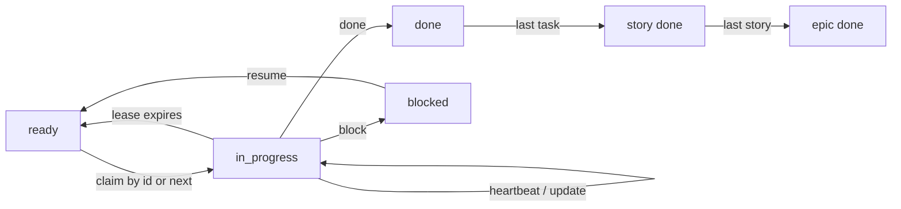
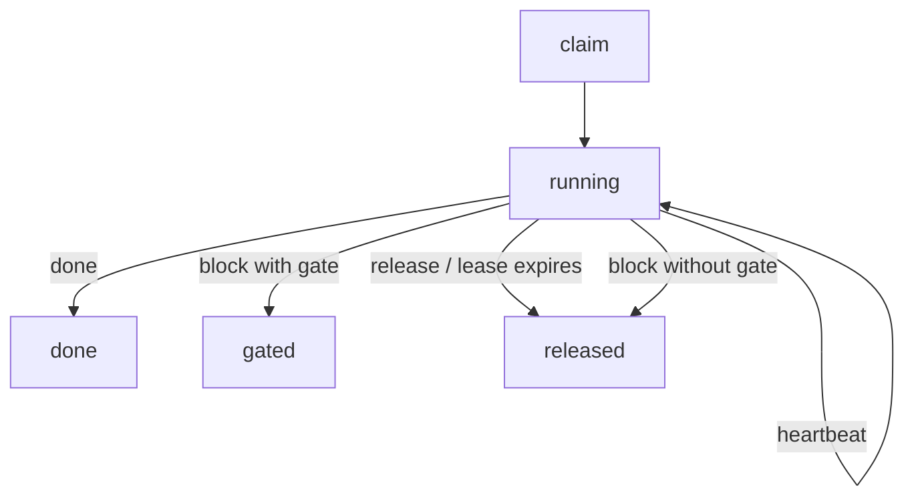
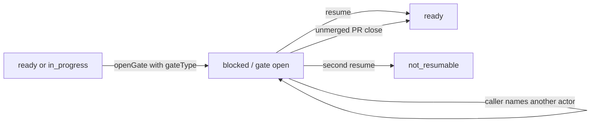

# Lifecycle

A task moves from `ready` through a claim to `done`. A block parks it until an
operator resumes it; closing the last task closes its story, and the last story
closes the epic.

## Task lifecycle

A lease expiry keeps the assignee so a dispatcher can re-wake the same worker;
only the status returns to `ready`.

Delegation keeps the accountable on the parent: a child task carries the
worker, the parent depends on it and waits in `blocked`, and the watcher
returns the parent to `ready` for the accountable when every child is
terminal.

## Attempt lifecycle

At `MAX_ATTEMPTS` the sweeper blocks the task instead of requeueing it.

## Gate lifecycle

Claim leases, attempt caps, and gate checks:

- **Claim**: atomic CAS under a lease. Highest-priority ready task selected when no id given. Human work uses the reserved `human` / `human_in_the_loop` pair: it keeps `ready`/`in_progress` but is never claimable by an agent.
- **Dependencies**: forward-only, cycle-checked. Cancelled deps count as resolved.
- **Gates**: `backlog_block` opens a gate when `gateType` is given; `backlog_resume` returns it to `ready` and clears the assignment. A caller that names another actor is refused.
- **Close**: closing the last task closes its story; closing the last story closes the epic and wakes the planner.
- **Starvation**: lives in the watcher manifest (deferred list, per-task idleMs).
- **Lease sweeper**: claims self-heal on next tick when the lease expires without heartbeats.
