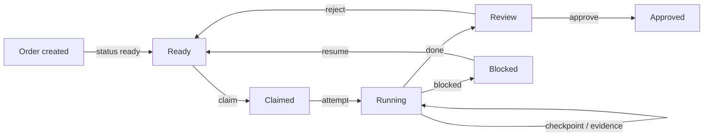
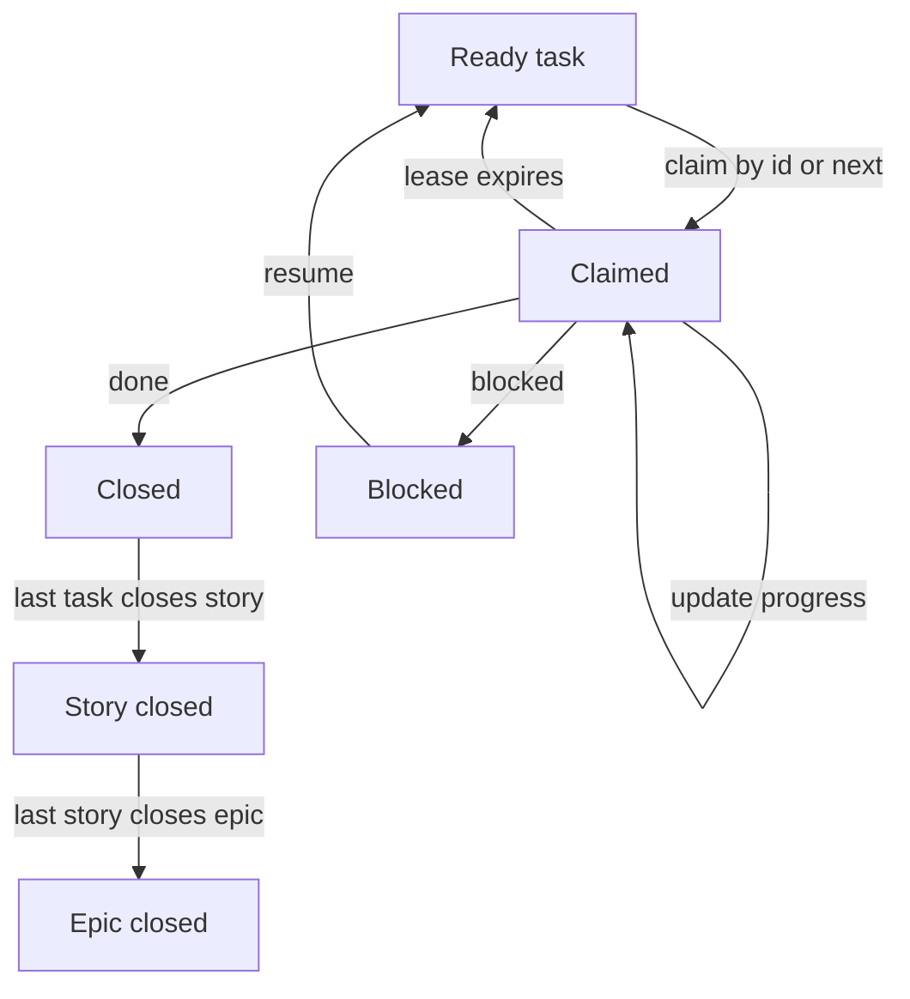
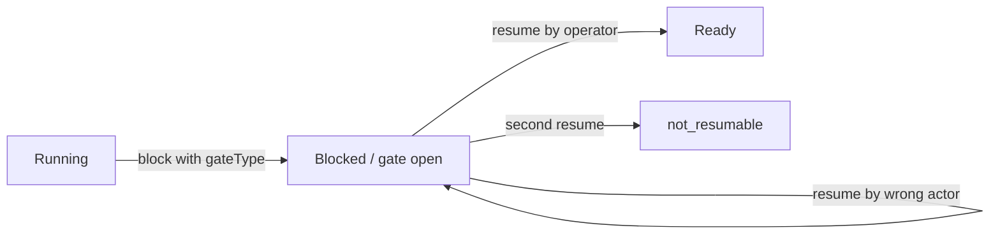

# Lifecycle

An order moves from ready through a claim and a running task to review. The
verdict decides where it lands, and resume returns rejected or blocked work to
ready.

## Order lifecycle

## Claim lifecycle

## Gate lifecycle

Claim leases, attempt caps, and the checkpoint/evidence validation rules.

- **Claim**: atomic CAS under a lease. Highest-priority ready task selected when no id given.
- **Dependencies**: forward-only, cycle-checked. Cancelled deps count as resolved.
- **Gates**: block/resume with gate types. One resume per gate. Actor-checked.
- **Close**: closing the last task closes its story; closing the last story closes the epic and wakes the planner.
- **Starvation**: lives in the watcher manifest (deferred list, per-task idleMs).
- **Lease sweeper**: claims self-heal on next tick when the lease expires without heartbeats.
