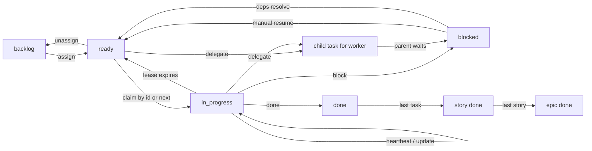
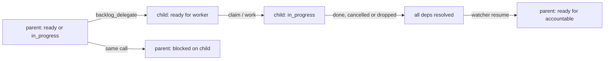
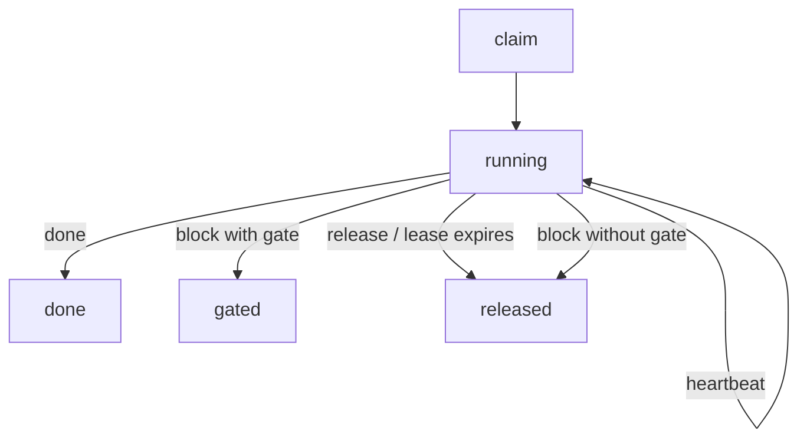
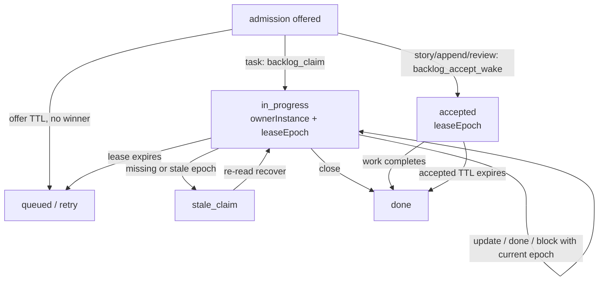
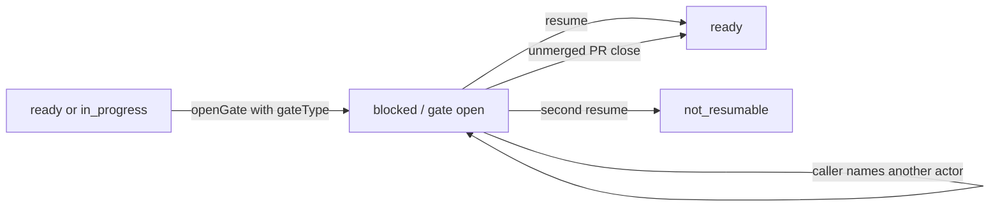

# Lifecycle

A task starts in `backlog`. Assignment moves it to `ready`, a claim moves it to
`in_progress`, and closing it moves it to `done`. A plain block parks it until
an operator resumes it; a dependency wait returns to `ready` on its own.
Closing the last task closes its story, and the last story closes the epic.

## Task lifecycle

A lease expiry keeps the assignee so a dispatcher can re-wake the same worker;
only the status returns to `ready`.

Delegation keeps the accountable on the parent: each child carries the
worker, the parent depends on every child and waits in `blocked`, and the
watcher returns the parent to `ready` for the accountable when every child is
terminal. A dependency-blocked parent accepts another child, so a fan-out can
be built in parallel. `childKey` + `visitSeq` make a retry idempotent and let
a later round reuse the lane. `backlog_block` with `blockedBy` enters the same
wait; a plain block requires `backlog_resume`.

## Attempt lifecycle

At `MAX_ATTEMPTS` the sweeper blocks the task instead of requeueing it.

## Dispatch execution lifecycle

Delivery fans out to every consumer; execution is single-flight. A task uses
`backlog_claim`; a story/append/review wake uses `backlog_accept_wake`. Tasks
stamp owner and epoch on the work attempt; planner acceptance stamps them on
the admission attempt.

A stale epoch is a refusal, not a takeover: the old session stops and re-reads
`POST /dispatch/recover`. A standby consumer never gets the attempt or start
row.

## Gate lifecycle

Claim leases, attempt caps, and gate checks:

- **Claim**: atomic CAS under a lease. Highest-priority ready task selected when no id given. Human work uses the reserved `human` / `human_in_the_loop` pair: it keeps `ready`/`in_progress` but is never claimable by an agent.
- **Dependencies**: forward-only, cycle-checked. Cancelled and dropped deps count as resolved; a dependency-wait parent returns to `ready` when every dep is terminal.
- **Gates**: `backlog_block` opens a gate when `gateType` is given; `backlog_resume` returns it to `ready` and clears the assignment. A caller that names another actor is refused. A block with `blockedBy` and no `gateType` is a dependency wait, not a gate.
- **Close**: closing the last task closes its story; closing the last story closes the epic and wakes the planner.
- **Starvation**: lives in the watcher manifest (deferred list, per-task idleMs).
- **Lease sweeper**: claims self-heal on next tick when the lease expires without heartbeats.
- **Fencing**: wake-owned attempts carry `ownerInstance` and `leaseEpoch`; `backlog_update`, `backlog_done` and `backlog_block` refuse a missing or stale epoch, and the relay promotes a standby with a new epoch when the active lease expires.
