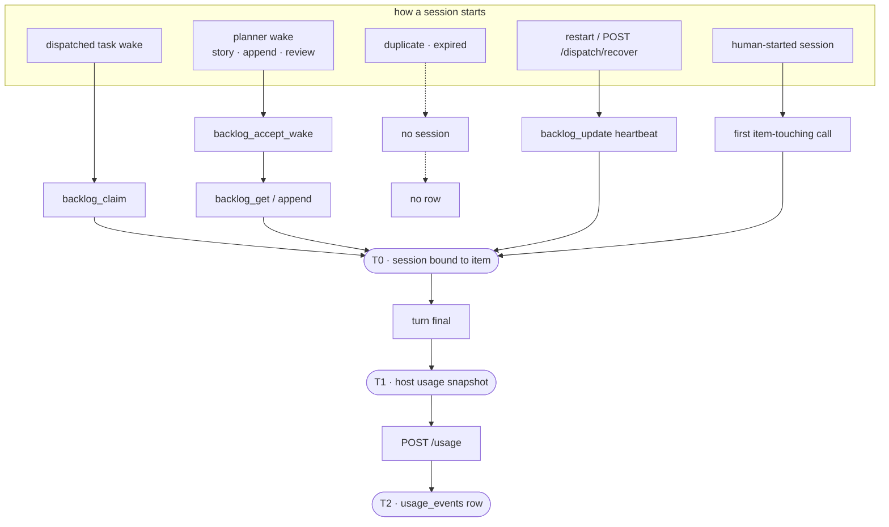
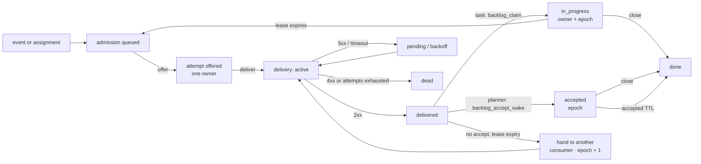

# Webhooks

Winch stores webhook subscriptions by topic and stable id. Dispatch is the
built-in topic: it delivers wake payloads over HTTP, and a receiver answers `202`
(or any 2xx) to accept delivery. Delivery is at-least-once and per consumer;
execution is single-flight. One consumer owns the attempt and is the only one
delivered to, as `execution: "active"`.

`winch webhook serve [--port N] [--host H]` starts the HTTP dispatch endpoints
and the wake pump. Webhook wakes are the main event driver: every work-making
transition fans out to consumers through this server.

## Subscriptions

The core stores subscriptions in `webhooks`, keyed by `(topic, id)`.
`harness` and `executor_id` are optional target metadata, so one id can carry
independent endpoints for different purposes. A managed dispatch subscription
is a lease: one live instance owns the route, and another instance may take over
only after the lease expires. Manual `winch webhook register` rows are stable
subscriptions, not leases; they have no heartbeat and are never swept.

    winch webhook bearer
    winch webhook register --topic T [--harness H] [--executor E] --url U [--id I] [--bearer B] [--timeout-ms N]
    winch webhook list [--topic T] [--harness H]
    winch webhook deliveries [--status S] [--admission ID] [--consumer ID] [--limit N]
    winch webhook revoke [--topic T] --id I
    winch webhook test [--topic T] [--harness H] [--id I]

`register` defaults to `--topic dispatch`. It derives a stable `manual-<hash>`
id from the URL when `--id` is omitted. For the dispatch topic, the executor id
defaults to the subscription id and `--harness` is required. If `--bearer` is
omitted it uses `WINCH_WEBHOOK_BEARER`, then generates one and prints it once;
later `list` output redacts it. The bearer is sent as
`Authorization: Bearer …` on every delivery.

`list` shows every topic unless `--topic` is given, including disabled rows.
`deliveries` reads the per-consumer ledger; `--status dead` is the dead-letter
view, and `--admission` scopes it to one wake across retries.
`revoke` and `test` default to `dispatch`; `test` pings every subscription in
the selected topic or id. A managed row is `managed: true`; manual rows are
`managed: false` and retained regardless of last-seen.

## Serving

The dispatch server listens on `WINCH_DISPATCH_PORT` (default `38293`) and
localhost-only unless `--host` says otherwise:

    winch webhook serve [--port N] [--host H]

It also sweeps expired managed leases on `WINCH_DISPATCH_SWEEP_MS`. Disabled
rows are retained for audit; manual rows are never swept.

Management endpoints accept `Authorization: Bearer $WINCH_DISPATCH_TOKEN` when
that variable is set. A non-loopback `--host` refuses to start without it.

## Usage ingestion

The harness posts per-turn LLM usage to the dispatch server. The body names the
caller's `sessionKey` and the usage object; winch resolves the session's item
and writes one `usage_events` row.

    POST /usage
    Authorization: Bearer $WINCH_DISPATCH_TOKEN
    {"sessionKey":"<harness>:<agent>:<externalSession>",
     "turnRef":"<provider turn id, optional>",
     "usage":{"model":"…","tokensIn":0,"tokensOut":0,"cacheRead":0,"costUsd":0.0,"toolCalls":0}}

`usage` accepts snake_case aliases (`tokens_in`, `tokens_out`, `cache_read`,
`cost_usd`, `cost`, `tool_calls`). An unknown `sessionKey` returns `404`; an
empty usage object returns `400`. The row links `item_id` (NOT NULL),
`session_id`, and the item's live `attempt_id` when one exists. A non-null
`turnRef` is unique per `(harness, agent_id, external_session_id)`, so retries
are idempotent and a duplicate returns `{"duplicate":true}`. A session is bound
to its item at claim and on any item-touching call; `backlog_accept_wake`
carries only an admission id, so on its own it does not bind. This endpoint
replaces the former WebSocket usage frame.

### Trigger points

Every way a session can start converges on the same three points. T1 is
host-specific: OpenClaw fires on `reply_payload_sending` (one consumed
`usageState` per run), OpenCode on a final `message.updated`.

| journey | T0 arms on | note |
|---|---|---|
| dispatched task | `backlog_claim` | the claim is both the work CAS and the bind |
| planner wake | `backlog_get` / `backlog_append` | `backlog_accept_wake` guards the wake but carries no item id, so it does not bind |
| restart / resume | `backlog_update` | heartbeat the same attempt with `attemptId` + `leaseEpoch`; never re-claim |
| human session | first item-touching call | no dispatch involved |
| duplicate / expired | — | no session starts, so no row |

T2 is shared: `POST /usage` for every row above. T1 is every finalized turn,
not every model call — the tool-loop aggregate is the row.

## Live enqueue

A status transition writes its wake rows into `admission_queue` inside the same
SQLite transaction as `item_state` and `item_events`. The writer then posts to
`/dispatch/notify` on the dispatch base URL (`WINCH_DISPATCH_URL`, default
`http://127.0.0.1:38293`) so the dispatcher drains immediately. The
notification is best-effort; the queue is durable. On startup the dispatcher
replays `item_events` to repair queues written before this path existed, and
`enqueue` deduplicates by event id. The interval pump remains only for offer
expiry, retry backoff and lost notifications.

## Dispatch registration

Nothing wakes without a subscription. The pump only offers queued admissions
to harnesses present in `webhooks`, so an assignment whose harness matches no
enabled subscription succeeds and then sits `queued` forever — no attempts, no
deliveries, no error at the write. The tools surface this instead of hiding
it: `backlog_assign` returns `warning: {code: "no_route", harness, message}`
when no enabled `dispatch` subscription matches the harness (state
`disabled` counts as no route), and `backlog_plan` returns the same warning
when no `dispatch` subscription exists at all. The write itself still
succeeds; the warning is the signal to register before expecting progress.
The reserved `human_in_the_loop` harness never routes, so human assignments
never warn.

Manual registration:

    winch webhook bearer
    winch webhook register --topic dispatch --harness <harness> --url <receiver-url> --bearer <token>

Each adapter exposes one wake route for its consumer and registers it on the
`dispatch` topic. The event's `kind` decides what the listener does; the
executor is the live instance, so a consumer never needs a second webhook:

    POST /dispatch/register
    {"harness":"openclaw","consumerId":"openclaw:host","executorId":"openclaw-1","instanceId":"openclaw-1","url":"http://127.0.0.1:18789/api/winch/dispatch","bearer":"…","fresh":true}

`consumerId` is the webhook identity; `executorId`/`instanceId` is the live
process. Registration is a lease. `fresh: true` is sent once on process start;
later reconciles send `fresh: false` and only refresh `lastSeenAt`/the lease.
A heartbeat never clears `suspect`/`disabled` or the failure count. A different
instance gets `409 {"code":"stale_instance"}` while the current lease is live;
once the lease expires it takes over and `generation` increments. A fresh
registration re-enables a disabled row.

The server keeps a `state`:

- `active` — healthy, receives deliveries.
- `suspect` — a transient failure occurred; still receives retries and is
  disabled after `WINCH_DISPATCH_DELIVERY_FAILURE_THRESHOLD` (default 4).
- `disabled` — no deliveries. A `4xx` (except `408`, `425`, `429`) disables
  immediately; `404`/`410` therefore stop cleanly. A plain heartbeat does not
  re-enable it; a fresh process registration does, after which the normal
  failure policy applies again.

A stale **managed** `lastSeenAt` older than `WINCH_DISPATCH_CONSUMER_TTL_MS`
(default 90s) is pruned by the sweep. Disabled rows are retained for audit and
manual rows are never swept. Multiple consumers may share a
harness; each gets a delivery.

The adapter environment supplies the identity:

| variable | meaning |
|---|---|
| `WINCH_HARNESS` | harness name; must match the MCP connection |
| `WINCH_CONSUMER_ID` | stable consumer id; default `harness:hostname` |
| `WINCH_EXECUTOR_ID` | unique id for this live connection |
| `WINCH_WEBHOOK_BEARER` | receiver token; generate with `winch webhook bearer` |
| `WINCH_DISPATCH_URL` | winch base URL, default `http://127.0.0.1:38293` |
| `WINCH_DISPATCH_TOKEN` | optional management bearer for register/recover/notify; required for a non-loopback bind |

Adapters fail closed when `WINCH_EXECUTOR_ID` or `WINCH_WEBHOOK_BEARER` is
missing. Plugin config can supply `winchHarness`, `winchConsumerId`, and
`winchExecutorId`; the environment is the fallback.

The window that bounds running children lives in the webhook server, not the
adapter. A delivery counts as running from acceptance until the receiver
reports the child's exit with `POST /dispatch/notify`
(`{"type":"settle","admissionId":"ADM-…","consumerId":"…"}`). The server hands
out at most `WINCH_DISPATCH_WAKE_MAX` running children per consumer (default
`8`) and never a second wake for an admission that is already running, so an
offer re-offered while its child is alive cannot stack another process. A
receiver that never settles stops consuming the window once its delivery lease
(`WINCH_DISPATCH_DELIVERY_LEASE_MS`) lapses, so a crashed receiver cannot wedge
dispatch. The adapter still refuses a duplicate wake for a key it is already
running: that guard covers the pump/recover race, not the cap.

The registration target must match the running dispatch server:
`WINCH_DISPATCH_URL` defaults to `http://127.0.0.1:38293`, so a server
started with `winch webhook serve --port 38493` needs
`WINCH_DISPATCH_URL=http://127.0.0.1:38493` in the adapter environment.
When the ports disagree, registration fails (`dispatch register failed` in
the plugin log), `webhooks` stays empty, and every later assignment warns
`no_route` while both processes run.

## Dispatch routing

The server routes work-making transitions into `admission_queue`:
`task.created`, `task.assigned`, `task.released`, `task.restored`,
`gate.resolved`, `story.created`, `story.assigned`, `task.appended` (to the
epic creator), and `epic.completed` (to the epic creator).

- Each dispatch attempt has a stable `dispatch_events` row, one
  `webhook_deliveries` row for the attempt's owner, and a
  `webhook_delivery_attempts` audit row per HTTP try. A queued wake is POSTed to
  the owner only. `202` means the receiver accepted the request; it does **not**
  mean the work was claimed.
- The owner receives `execution: "active"` and is the only consumer that starts
  a session. If its delivery dies or its lease expires, the dispatcher hands the
  attempt to another consumer of the same harness, increments `leaseEpoch`, and
  delivers that one as active.
- Tasks still use the agent's MCP `backlog_claim` as the work CAS. A wake-owned
  claim records `consumerId`, `ownerInstance`, and a positive `leaseEpoch` on
  the work attempt; `backlog_update`/`backlog_done`/`backlog_block` reject a
  missing or stale epoch. The winning consumer is the only one that resumes.
- Append/review/story wakes have no task claim. The active receiver must call
  `backlog_accept_wake` with `admissionId`, `attemptNo`, and `leaseEpoch`; that
  CAS sets `accepted_at`, renews the execution lease, and is the single-flight
  guard. An unaccepted planner wake requeues at the offer TTL instead of
  disappearing.
- Each delivery retries independently: one 202 does not hide a peer's 500.
  The delivery row moves `pending → delivering → delivered|dead` (or back to
  `pending` for retry); the admission row becomes `active` when the item is
  claimed and closes when the item closes.
- A failed delivery, an expired offer, or a wake that is never claimed
  requeues with exponential backoff. The relay claims rows with a delivery
  lease, so two servers cannot send the same row concurrently. Offer TTL,
  delivery backoff, attempts, per-harness cap and global cap are in
  [Configuration](configuration.md).

## Delivery and execution states

`dead` is a delivery outcome, not a task outcome: it is visible in
`winch webhook deliveries --status dead`, and the same attempt can still be
handed to another consumer.

## Wake payload

Winch POSTs this JSON body:

    {
      "type": "wake",
      "admissionId": "ADM-…",
      "itemId": "TASK-…",
      "attemptNo": 1,
      "kind": "task",
      "harness": "openclaw",
      "agent": "worker",
      "eventId": 42,
      "offerExpiresAt": 1730000000000,
      "execution": "active",
      "leaseEpoch": 0,
      "at": 1729999880000
    }

The receiver should verify the bearer, keep the request bounded, and return 2xx
once the wake is queued locally. The receiver is the attempt's owner and is the
only one that starts a session.
For `task` wakes, the agent wins the work with `backlog_claim`; for
`story`/`append`/`review`, it must first call `backlog_accept_wake` with the
payload's `admissionId`, `attemptNo`, and `leaseEpoch`. A non-2xx response
retries that consumer independently with backoff. The payload is a pointer,
not a brief: the agent reads the record with `backlog_get`.

## Testing

`winch webhook test --topic T [--harness H] [--id I]` sends:

    {"type":"ping","topic":"T","id":"I","harness":"H","executorId":"E","at":1730000000000}

Both bundled receivers answer `200 {"ok":true,"test":true}`. A custom receiver
may do the same, or return any 2xx. The command reports each subscription's
status and exits non-zero if any fails.

## Restart recovery

`POST /dispatch/recover` is the restart path. It hands over offered work and,
when `mutate` is set, fills free capacity — including re-admitting ready
assigned work for the harness whose last admission expired, so a restart drains
the backlog instead of leaving it dormant. Both steps stay inside the harness
and global caps and the consumer's wake window:

    POST /dispatch/recover
    {"harness":"openclaw","consumerId":"openclaw:host","executorId":"openclaw-1"}

It returns:

- `resume`: assigned `in_progress` work with `task`, `attemptId`,
  `sessionId`, `sessionKey`, `leaseEpoch`, `ownerInstance`, and
  `leaseExpiresAt`. The winning claim records the consumer on the work
  attempt; only that consumer gets its resume. A claim that never named a
  consumer is not fanned out to any of them (fail closed);
- `start`: already-offered wakes whose `activeConsumerId` is this consumer. Any
  other consumer receives none;
- `free`: remaining capacity after active and offered work. The server pump
  performs any expiry, cap trim, or free-slot fill; this endpoint does not.

The harness resumes the same attempt, never re-claims an `in_progress` item.
Its first action is `backlog_update` with the returned `attemptId` **and
`leaseEpoch`**; a stale attempt or epoch gets `stale_claim`. Only an expired
lease returns the item to `ready`, where normal wake and claim apply.

## Receiver requirements

- Accept `POST` on a stable URL reachable from the winch server.
- Require the executor bearer; reject a mismatched or missing one.
- Deduplicate on `admissionId` + `attemptNo`; a duplicate wake must not start
  a second local session.
- Start when `execution` is `"active"`; treat a missing field as active.
- For `story`/`append`/`review`, call `backlog_accept_wake` before doing the
  work; a 202 without acceptance is retried, not treated as completed.
- Register on boot with `fresh: true` and a stable `instanceId`, then
  re-register with `fresh: false` on every reconcile so the lease stays fresh.
  A `409` means another live instance owns this consumer; do not call recover
  until the lease is yours. A heartbeat must not clear a failure or re-enable a
  disabled receiver.

## Delegation

`backlog_delegate` can carry `childKey` and `visitSeq`. A retry of the same pair
returns the existing child; a higher `visitSeq` starts a new round. The parent
waits on all children, and the last child offered moves `current_child_key`.
`backlog_append` wakes the epic creator, not the task assignee.
